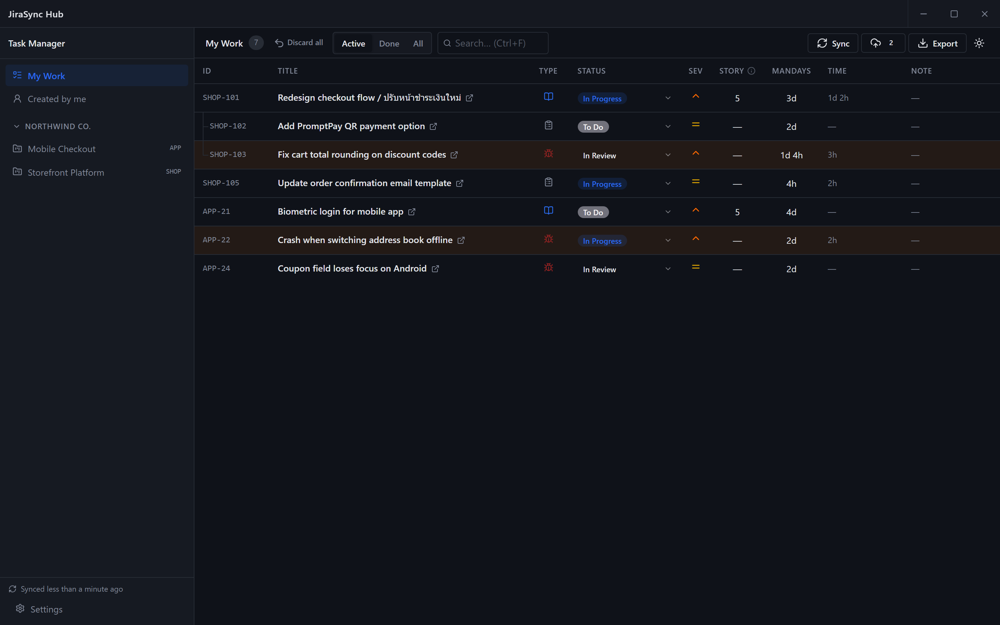
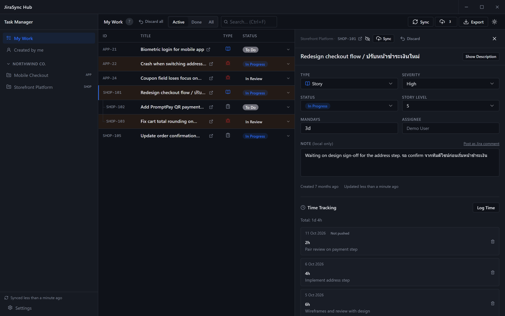
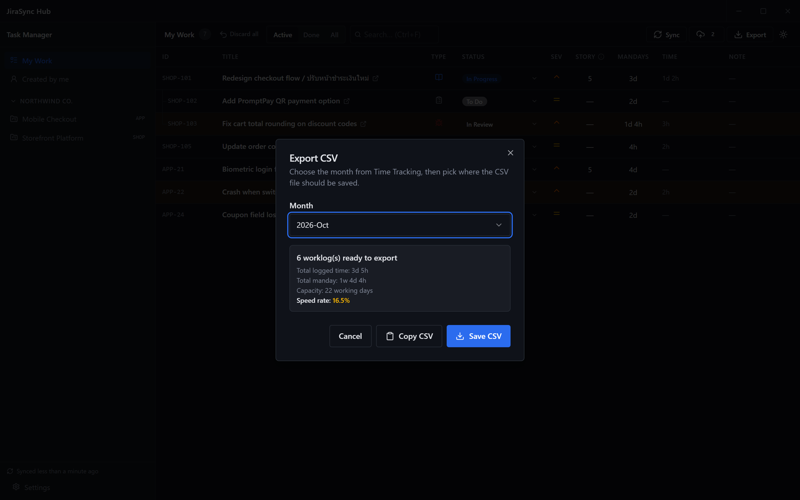
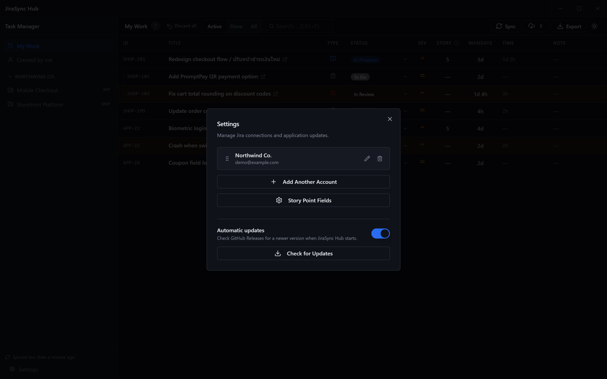
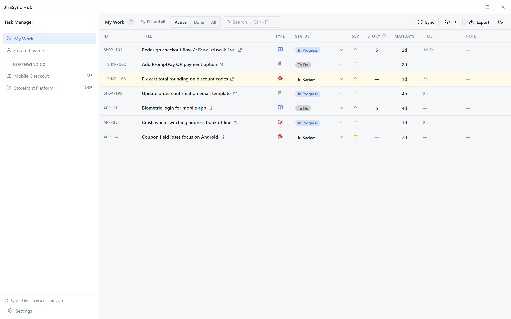

<div align="center">

# JiraSync Hub

**Your Jira tickets, on your desktop, even when Jira isn't.**

Pull the tickets assigned to you, edit and log work offline, then push back only what you actually changed. No browser tabs, no waiting on Jira's UI.

[](https://github.com/dvgamerr-app/jirasync-hub-app/stargazers)
[](https://github.com/dvgamerr-app/jirasync-hub-app/releases/latest)


[Website](https://dvgamerr.app/jirasync-hub-app/) · [Download](#install) · [Quick start](#quick-start) · [ภาษาไทย](README.th.md)



</div>

> ⭐ **If JiraSync Hub saves you a few Jira clicks, a star helps other Jira users find it.**

## Why

- **Your work stays on your machine.** Tasks and worklogs live in a local database (IndexedDB). Browse, search and edit with no network.
- **Push only what you touched.** The app tracks which fields you changed and sends just those. Log time on a ticket and its priority, story points and description are never rewritten.
- **Token stays in the OS keychain.** The Jira API token is stored in Windows Credential Manager or macOS Keychain, and the app talks to Jira directly. There is no server in between.
- **Time reporting that is honest.** Teammates' worklogs show read-only and are never counted in your totals or CSV export.

## Features

|     | Feature                   | What it does                                                                      |
| --- | ------------------------- | --------------------------------------------------------------------------------- |
| 🔄  | **Incremental sync**      | Hourly background pull of only what changed; a full sync on demand                |
| ✏️  | **Offline editing**       | Status, type, severity, story level, mandays, local note and worklogs             |
| 🚀  | **Selective push**        | Per-task or all-at-once, with field-level dirty tracking                          |
| ⏱️  | **Worklogs**              | Add and delete time, with input preview (`2` = 2 hours, `1d 4h 30m` also works)   |
| 🔀  | **Workflow-aware status** | Status changes go through Jira transitions; failures tell you why                 |
| ↩️  | **Discard**               | Restore a task from Jira, per task or all at once                                 |
| 📊  | **CSV export**            | Monthly worklog export, UTF-8 BOM for Excel, warns about unpushed time            |
| 🏢  | **Multi-account**         | Several Jira Cloud sites side by side, with per-project story point field mapping |
| 🔐  | **Keychain secrets**      | API tokens in the OS credential store, not in app data                            |
| 🖥️  | **Desktop native**        | Tauri 2 app for Windows, macOS and Linux with built-in updater                    |

<details>
<summary>More screenshots</summary>

|                                                                              |                                                                 |
| ---------------------------------------------------------------------------- | --------------------------------------------------------------- |
|  |  |
|         |   |

</details>

## Install

Download the latest build from [**GitHub Releases**](https://github.com/dvgamerr-app/jirasync-hub-app/releases/latest):

| OS      | File                                                                          |
| ------- | ----------------------------------------------------------------------------- |
| Windows | `.exe` / `.msi` (also a portable `.exe`; needs WebView2 Runtime)              |
| macOS   | `.dmg` (not notarised yet, see [the macOS note](docs/user-guide.th.md#macos)) |
| Linux   | `.AppImage` / `.deb`                                                          |

The app checks Releases for updates on launch.

## Quick start

You need a **Jira Cloud** site (`*.atlassian.net`), your Atlassian email, and an [API token](https://id.atlassian.net/manage-profile/security/api-tokens).

1. Open the app → **Settings** → **Add Account**.
2. Enter the instance (`acme` or `https://acme.atlassian.net`), email and token, press **Test**, then **Save & Connect**.
3. Press **Sync** to pull your projects, tasks and worklogs.
4. Edit tasks. Changed rows are highlighted until pushed. Press the upload button (or a task's own **Sync**) to push.

Jira Server / Data Center is not supported.

## How it works

```
Jira API ──pull──► IndexedDB (Dexie) ──► Zustand ──► React UI
                                              ▲
              local edits (dirty fields) ─────┘
                                              │
                    push only changed fields ─┴──► Jira API
```

Tauri 2 · React 19 · Vite · Tailwind + shadcn/ui · Zustand · Dexie · Playwright e2e against a fake Jira.

## Documentation

- [User guide (ภาษาไทย)](docs/user-guide.th.md): full walkthrough
- [Architecture](docs/architecture.md)
- [Technical debt & backlog](docs/technical-debt.md)

## Develop

```bash
bun install
bun tauri dev          # run the desktop app
bun run test           # unit tests
bun run test:e2e       # Playwright against a fake Jira (bun x playwright install chromium first)
bun run lint
bun run build          # type-check + build
bun run cg:check       # cargo check
```

## Support the project

- ⭐ [Star the repo](https://github.com/dvgamerr-app/jirasync-hub-app)
- 🐛 [Report an issue](https://github.com/dvgamerr-app/jirasync-hub-app/issues)

_Not affiliated with or endorsed by Atlassian. Jira is a trademark of Atlassian._
